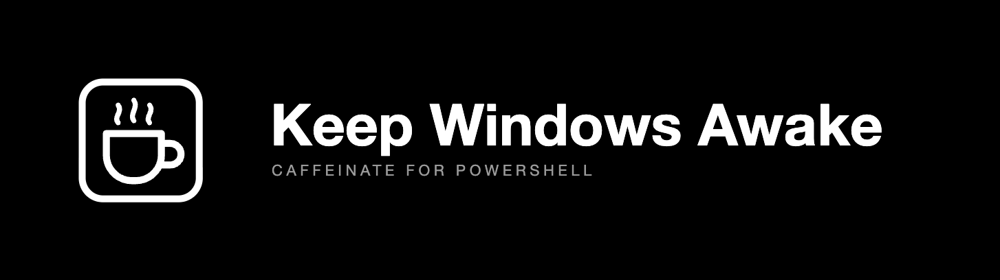

# Keep Windows Awake



[](https://github.com/ysskrishna/keep-windows-awake/actions/workflows/validate.yml) [](https://github.com/ysskrishna/keep-windows-awake/blob/main/LICENSE) [](https://github.com/ysskrishna/keep-windows-awake/releases) [](https://ysskrishna.space)

A PowerShell command, `caffeinate`, that keeps a Windows PC awake with the same flags as the macOS `caffeinate` (`-d`, `-i`, `-t`, `-w`). It needs no installer, no PowerToys, no winget and no elevation, and it writes nothing to disk. This repo also has a [guide to what still works](docs/methods.md) when IT has locked the laptop down.

## Quick start

1. Open PowerShell. A normal window is enough.
2. Open [`src/caffeinate.ps1`](src/caffeinate.ps1) on GitHub, click **Copy raw file**, paste it into PowerShell and press Enter. That defines the command for this window only.
3. Run it:

```powershell
caffeinate -d -t 3600
```

That keeps the system and the display awake for one hour. Press **Ctrl+C** to stop sooner. When it ends, Windows follows its normal sleep settings again.

Pasting works even when script files are blocked, because the execution policy applies to script files and profiles, not to text typed at the prompt ([Microsoft](https://learn.microsoft.com/en-us/powershell/module/microsoft.powershell.core/about/about_execution_policies)). It does not work if the session is in Constrained Language mode. The command tells you so in one line.

## Which method works on my laptop?

| Your situation | What to use |
|---|---|
| Nothing blocked, or only installers (PowerToys, winget) are | `caffeinate`, pasted or from the file |
| Script files are blocked (execution policy) | Paste the file into the console |
| PowerShell is in Constrained Language mode (AppLocker or WDAC) | `caffeinate` cannot run. Use Presentation Settings or the power plan |
| Windows Home edition | Power plan in Settings |
| A Group Policy locks the session after inactivity | Nothing here stops it |

Each method, what it needs, what it cannot do and how to undo it is in [docs/methods.md](docs/methods.md).

## Usage

```powershell
caffeinate                  # keep the system awake until Ctrl+C
caffeinate -d               # also keep the display on
caffeinate -t 3600          # stop after 3600 seconds
caffeinate -d -t 3600       # display on, for one hour
caffeinate -w 4242          # stop when process 4242 exits
caffeinate -t 3600 -w 4242  # stop at whichever comes first
```

| Flag | macOS `caffeinate` | This command |
|---|---|---|
| `-d` | Prevent the display from sleeping | Holds the display and the system |
| `-i` | Prevent idle sleep | Accepted. Already the default |
| `-t <seconds>` | Stop after this time | Same. Whole seconds, 1 or more |
| `-w <pid>` | Stop when this process exits | Same |
| `-m`, `-s`, `-u` | Disk idle, system sleep on AC, user active | Not supported. Prints a one-line message |
| `caffeinate -i make` | Stay awake while a command runs | Not supported. Use `-w <pid>` |

With no flags, both hold only the system awake. The display can still turn off. With no `-t` or `-w`, both run until you stop them. The exit code is `0` on success, `2` for a bad argument and `1` for anything else, such as a blocked session.

macOS and Linux equivalents are in [docs/macos-linux.md](docs/macos-linux.md).

## What it cannot do

It asks Windows not to sleep, the way a video player does. It does not press keys or move the mouse. Microsoft documents these limits of the API it uses ([SetThreadExecutionState](https://learn.microsoft.com/en-us/windows/win32/api/winbase/nf-winbase-setthreadexecutionstate)):

- It cannot stop you, or a policy, from putting the PC to sleep with the lid, the power button or Start > Sleep.
- It does not stop the screen saver.

A Group Policy such as "Interactive logon: Machine inactivity limit" locks the session after a period without *user input* ([Microsoft](https://learn.microsoft.com/en-us/previous-versions/windows/it-pro/windows-10/security/threat-protection/security-policy-settings/interactive-logon-machine-inactivity-limit)). A wake request is not user input, so such a lock is not expected to stop. See [docs/methods.md](docs/methods.md#5-a-group-policy-lock).

## Other ways to use it

<details>
<summary><b>As a file</b></summary>

Download `caffeinate.ps1` from the [latest release](https://github.com/ysskrishna/keep-windows-awake/releases/latest), or copy [`src/caffeinate.ps1`](src/caffeinate.ps1). Then:

```powershell
.\caffeinate.ps1 -d -t 3600
```

Or load it as a command for the session:

```powershell
. .\caffeinate.ps1
caffeinate -t 3600
```

If Windows says the file cannot be loaded, the execution policy is blocking script files. Paste the file instead (Quick start). A file downloaded in a browser also carries a "from the internet" mark, which `RemoteSigned` blocks until you run `Unblock-File .\caffeinate.ps1`. Only do that for a file you have read.

</details>

<details>
<summary><b>Check a release download</b></summary>

Each release has `caffeinate.ps1` and `caffeinate.ps1.sha256`. Compare the hash of your copy with the one in the `.sha256` file:

```powershell
(Get-FileHash .\caffeinate.ps1 -Algorithm SHA256).Hash
```

</details>

<details>
<summary><b>Available in every new window (PowerShell profile)</b></summary>

Save `caffeinate.ps1` somewhere permanent, then add a line to your profile that loads it:

```powershell
if (-not (Test-Path $PROFILE)) { New-Item -ItemType File -Path $PROFILE -Force | Out-Null }
Add-Content $PROFILE '. "C:\Tools\caffeinate.ps1"'
```

Change the path to where you saved the file. Windows PowerShell and PowerShell 7 each have their own `$PROFILE`, so repeat this in the one you use. Profiles are script files, so a restrictive execution policy stops them from loading. More in [docs/troubleshooting.md](docs/troubleshooting.md).

</details>

## Documentation

| Guide | What is in it |
|---|---|
| [docs/methods.md](docs/methods.md) | What works under which restriction, with commands and limits |
| [docs/troubleshooting.md](docs/troubleshooting.md) | Find out which restriction you hit, read each message, and common questions |
| [docs/macos-linux.md](docs/macos-linux.md) | The same job on macOS and Linux, with built-in tools |
| [docs/tested.md](docs/tested.md) | What was run, on what, and when |
| [docs/development.md](docs/development.md) | Tests, checks, releases |

Reporting a vulnerability: see [SECURITY.md](SECURITY.md).

## Built and maintained by

Keep Windows Awake is built and maintained by:

| | Name | GitHub | Role |
|---|------|--------|------|
|  | **Y. Siva Sai Krishna** | [@ysskrishna](https://github.com/ysskrishna) | Creator |

## Changelog

See [CHANGELOG](https://github.com/ysskrishna/keep-windows-awake/blob/main/CHANGELOG.md) for release history.

## Support

If you find this helpful:

- ⭐ Star the repository
- 🐛 Report issues
- 🔀 Submit pull requests
- 💝 [Sponsor on GitHub](https://github.com/sponsors/ysskrishna)

## License

MIT © [Y. Siva Sai Krishna](https://github.com/ysskrishna) — see [LICENSE](https://github.com/ysskrishna/keep-windows-awake/blob/main/LICENSE) for details.

---

<p align="left">
  <a href="https://github.com/ysskrishna">Author's GitHub</a> •
  <a href="https://linkedin.com/in/ysskrishna">Author's LinkedIn</a> •
  <a href="https://ysskrishna.space">Author's site</a> •
  <a href="https://github.com/ysskrishna/keep-windows-awake/issues">Report Issues</a>
</p>
